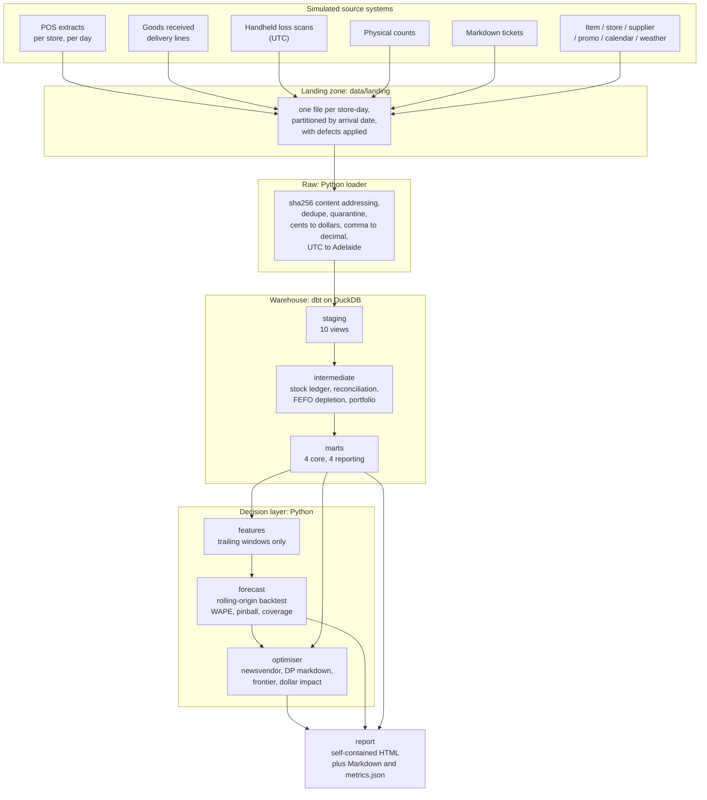

# fresh-shelf-ops

Waste and margin analysis for the fresh departments of an Australian supermarket
group. The estate is simulated. The pipeline and the decision logic are not.

The project answers three questions:

1. How much does a fresh department lose, and which of the three losses is it?
2. How much should each store order, for each line and each delivery?
3. When should the price be cut, and does the cut pay for itself?

The reporting date is 2026-09-10 and the last closed trading day is 2026-09-09.
Every layer reads that clock from `config/project.yml`. Nothing calls
`date.today()`, so a given seed and as-of date always produce the same numbers.

## The finding

One year, eight stores:

| Measure | Value | Share of sales |
|---|---:|---:|
| Net sales | $37.7M | |
| Recorded waste | $645k | 1.71% |
| Markdown erosion | $1.37M | 3.64% |
| Unrecorded shrink (estimated) | ~$144k | ~0.38% |

All four sit inside published Australian fresh-grocery benchmarks.

The useful number is the ratio between the first two losses: margin is 41.0% of
sales, so a unit that is not stocked costs about 24 times a unit that is wasted.
Ordering less therefore does not pay for itself. The cost curve has an interior
optimum at a service level of about 0.41, but a plan that simply orders down
captures only a fraction of the theoretical gain, because the margin it gives up
is much larger than the waste it avoids.

The defensible wins are in markdown timing and in the lines whose cover pattern
exceeds their shelf life. Not in a blanket cut to orders.

The optimiser's own accounting and the frontier disagree about the value of the
recommended plan. Both numbers appear in the report. See
[`docs/DECISIONS.md`](docs/DECISIONS.md#ad-11-publish-the-disagreement-between-the-two-methods).

## How it fits together



Two boundaries matter more than the rest:

- Landing is partitioned by when a file arrived. The loader reads the business
  date from the file contents, which is what lets a late file land in the right
  place without reopening a closed day.
- Units, timezone and duplicates are resolved once, in the loader. Nothing
  downstream re-derives them.

## Quick start

```bash
make setup     # venv and dependencies (uv), git hooks
make world     # simulate the source systems into data/landing
make daily     # ingest -> dbt build -> forecast -> optimise -> report
open build/report/index.html
```

A full run takes about two and a half minutes:

| Step | Time | Output |
|---|---:|---|
| `world` | 12s | 4,386 landed files (63 redeliveries) |
| `ingest` | 92s | 4,323 files loaded, 168 late, 0 quarantined |
| `build` | 12s | 69 dbt nodes (22 models, 44 tests) |
| `forecast` | 110s | 241,864 feature rows, 90 backtest rows |
| `optimise` | 1s | 9,436 plan rows |
| `report` | 0.1s | `build/report/index.html` |

For a faster loop, use the CI world: four stores over 180 days, the smallest
world that still exercises every catalogued defect.

```bash
make world-small && make daily      # about 40s
```

`STORES` and `DAYS` override the size (`make world-small STORES=2 DAYS=90`).
Smaller worlds stop producing the rare defects. At two stores and 90 days there
are no waste events at all, so the tests that assert each defect is still being
produced have nothing to check.

## Commands

Every task is idempotent and can be re-run. `make help` lists them.

| Command | Does |
|---|---|
| `make world` | Simulate the estate into the landing zone (dirty files and sealed truth) |
| `make ingest` | Load the landing zone into `raw` (dedupe, quarantine, manifests) |
| `make build` | `dbt deps && dbt seed && dbt build` |
| `make forecast` | Rolling-origin backtest and forward forecast |
| `make optimise` | Replenishment, markdown, frontier and dollar impact |
| `make report` | Render `build/report/index.html` |
| `make daily` | All of the above in order |
| `make status` | Latest run manifest and table inventory |
| `make idempotency` | Prove the loader is repeatable |
| `make check` | Lint and tests (what CI runs) |
| `make docs` | Static dbt docs site |

All commands accept `--as-of`, `--days` and `--stores`. A backfill is an
`--as-of` date in the past; CI uses `--stores 2 --days 90`.

## Real and simulated

The eight stores, the 104-item range, the suppliers, the weather, the demand and
the shelf mechanics are simulated. Nothing under `world/` comes from a real
retailer.

The pipeline is real: landing-zone handling, content-addressed idempotent
ingestion, per-source loaders that tolerate the defects they meet, a stock
ledger that reconciles against physical counts, FEFO depletion, a backtested
quantile forecast and a newsvendor optimiser.

Keeping the world simulated is what makes the defects testable. The simulator
writes its own answer key to `data/truth/`, the pipeline never reads it, and
`tests/` compares the pipeline's output against it.

## Defects the pipeline handles

Thirteen defects are catalogued in
[`config/defect_catalogue.yml`](config/defect_catalogue.yml), each with the
injection it simulates, the handling it requires and the test that proves the
handling works. Four examples:

| Code | Defect | Why it is dangerous |
|---|---|---|
| **D02** | Extracts land a day late | The file is a day older than the folder it sits in |
| **D05** | One store exports money in integer cents | Same column name, different unit, a silent 100x error |
| **D06** | Handhelds write UTC, everything else writes Adelaide time | Adelaide is +9:30/+10:30, so a 19:00 disposal can cross midnight and land on the wrong trading day |
| **D07** | A fifth of disposals are never scanned | Recorded waste is a floor, which is why the warehouse reconciles a ledger instead of trusting the file |

## Limits

These are also stated in the report.

- Recorded waste is a floor. Roughly a fifth of disposals are not scanned.
- Unrecorded shrink is a bound. Count error dominates it, and the published
  figure is weighted by a confidence score.
- The backtest sees perfect future weather. A real deployment would not.
- Markdown response is estimated from non-random history. Stores mark down the
  stock they expect to struggle, so the true response is understated.
- The ordering baseline is reconstructed from delivery history, not observed.
- The three loss figures are never summed. They have different fixes.

## Layout

```
config/          project.yml (the clock), defect_catalogue.yml
src/fresh_shelf/
  world/         the simulated estate: master data, calendar, weather, simulation
  landing/       writing dirty files to disk
  ingest/        the loader: per-source typing, dedupe, quarantine
  model/         features, forecast, optimiser
  report/        HTML, Markdown and metrics rendering, inline SVG charts
models/          dbt: staging -> intermediate -> marts
dbt_tests/       one singular test per catalogue defect
tests/           pytest: the world, the defects, the decisions, the report
docs/            ARCHITECTURE, DATA_DICTIONARY, DECISIONS, RUNBOOK
```

Start with [`docs/ARCHITECTURE.md`](docs/ARCHITECTURE.md) for the layer
boundaries, then [`docs/DECISIONS.md`](docs/DECISIONS.md) for the reasoning,
including the decisions that were reversed.

If you only want to review the result, [`docs/REVIEWING.md`](docs/REVIEWING.md)
lays out a ten-minute path through the finding, the files that carry the
engineering and the claims worth checking.
