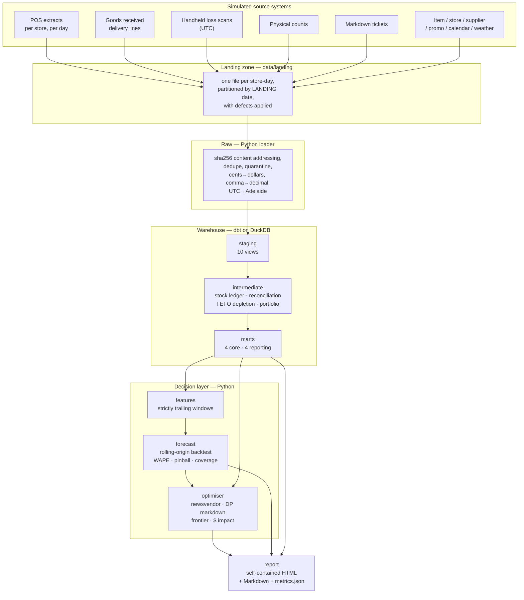

# fresh-shelf-ops

Waste-versus-revenue optimisation for short-shelf-life fresh departments in an
Australian supermarket group.

Three questions, answered with a working pipeline rather than a notebook:

1. **How much does a fresh department actually lose,** and which of the three
   different losses is it losing? Margin given away to sell stock in time, stock
   thrown away, and loss that no record explains are three problems with three
   different fixes.
2. **How much should each store order,** per line, per delivery? The answer is a
   property of each line's margin against its cost, not an estate-wide service
   level.
3. **When should the price be cut** — and does cutting it ever pay for itself?

**Reporting date: 2026-09-10.** The last closed trading day is 2026-09-09. Every
layer reads its clock from `config/project.yml` and nothing in the codebase calls
`date.today()`, so the whole project is reproducible: the same seed and the same
as-of date produce the same numbers, forever.

---

## The headline result

A year across eight stores: **$37.7M net sales, $645k of recorded waste
(1.71% of sales), $1.37M of markdown erosion (3.64%), and ~$144k of estimated
unrecorded shrink.** Those all sit inside published Australian fresh-grocery
benchmarks.

The interesting result is not the totals. It is that **ordering less does not pay
for itself here**, and the pipeline says so:

| | |
|---|---|
| Waste as a share of sales | **1.71%** |
| Margin as a share of sales | **41.0%** |
| Cost of a unit not stocked (margin forgone) | **~24× the cost of a unit wasted** |

So the ordering trade-off has an interior optimum — a service level around
**0.41** on this estate — but a plan that simply orders down realises only a
fraction of the theoretical gain, because the margin it gives up is so much
larger than the waste it avoids.

**The honest conclusion:** the defensible wins are in *markdown timing* and in
the specific lines whose cover pattern exceeds their shelf life — not in a
blanket reduction in ordering. The optimiser's own accounting and the frontier
disagree on the plan's net value, and both numbers are on the report rather than
one being quietly preferred. See [`docs/DECISIONS.md`](docs/DECISIONS.md#ad-11).

---

## Architecture



Two boundaries carry most of the design:

- **Landing is partitioned by when a file *arrived*; the loader reads the
  business date from its *contents*.** That is what makes a late file land in the
  right place rather than re-opening a closed day.
- **Nothing downstream of `raw` re-derives units, timezone or duplicates.** Those
  conversions happen exactly once, and the contract is tested.

---

## Quick start

```bash
make setup     # venv + dependencies (uv), git hooks
make world     # simulate the source systems into data/landing
make daily     # ingest -> dbt build -> forecast -> optimise -> report
open build/report/index.html
```

`make daily` on the full estate takes about **2.5 minutes**:

| Step | Time | Output |
|---|---:|---|
| `world` | 12s | 4,386 landed files (63 redeliveries) |
| `ingest` | 92s | 4,323 files loaded, 168 late, 0 quarantined |
| `build` | 12s | 69 dbt nodes (22 models, 44 tests) |
| `forecast` | 110s | 241,864 feature rows, 90 backtest rows |
| `optimise` | 1s | 9,436 plan rows |
| `report` | 0.1s | `build/report/index.html` |

A smaller world for a quick loop: `make world-small` then
`fresh_shelf.cli run --stores 2 --days 90`.

---

## Commands

Every task is idempotent and re-runnable. `make help` lists them all.

| Command | Does |
|---|---|
| `make world` | Simulate the estate into the landing zone (dirty files + sealed truth) |
| `make ingest` | Load the landing zone into `raw` (dedupe, quarantine, manifests) |
| `make build` | `dbt deps && dbt seed && dbt build` — the whole transform DAG |
| `make forecast` | Rolling-origin backtest + forward forecast |
| `make optimise` | Replenishment, markdown, frontier and dollar impact |
| `make report` | Render `build/report/index.html` |
| `make daily` | All of the above in order |
| `make status` | Latest run manifest and table inventory |
| `make idempotency` | Prove the loader is repeatable |
| `make check` | Lint + tests (what CI runs) |
| `make docs` | Static dbt docs site |

All of them accept `--as-of`, `--days` and `--stores`, so a backfill is just
`--as-of` a past date and CI is `--stores 2 --days 90`.

---

## What is real and what is simulated

**Simulated:** the eight stores, the 104-item fresh range, the suppliers, the
weather, the demand, and the way stock moves through a shelf. Nothing in
`world/` is data from a real retailer.

**Real:** the pipeline. Landing-zone handling, content-addressed idempotent
ingestion, per-source loaders that tolerate the defects they will actually meet,
a stock ledger that reconciles against physical counts, a FEFO depletion model, a
backtested quantile forecast, and a newsvendor optimiser are all genuine
engineering against a realistic problem.

That split is deliberate: it is the only way to demonstrate that a pipeline
handles a defect *and* to prove it did, because a simulated world can hand over
its own answer key. `tests/` compares the pipeline's output against
`data/truth/*.parquet`, which the pipeline itself never reads.

---

## What the pipeline has to survive

Thirteen defects, each catalogued in
[`config/defect_catalogue.yml`](config/defect_catalogue.yml) with the injection
it simulates, the handling it demands, and the test that proves the handling
works. The four that matter most:

| Code | Defect | Why it is dangerous |
|---|---|---|
| **D02** | Extracts land a day late | Party to a whole class of silent misfilings: the file is a day older than the folder it sits in |
| **D05** | One store exports money in **integer cents** | Same column name, different unit — the classic silent 100× error |
| **D06** | Handhelds write **UTC**, everything else writes Adelaide time | Adelaide is +9:30/+10:30, so a 19:00 disposal can cross midnight and land on the wrong trading day |
| **D07** | **A fifth of disposals are never scanned** | Recorded waste is a floor, not the loss — which is why the warehouse reconciles a ledger instead of trusting the file |

---

## Caveats

Stated here and repeated in the report itself, because a caveat in a docstring is
a caveat nobody reads.

- **Recorded waste is a floor.** Roughly a fifth of disposals are unscanned.
- **Unrecorded shrink is a bound.** It over-states unscanned loss several-fold
  because physical-count error dominates; the published figure is weighted by a
  confidence score.
- **The backtest has perfect future weather.** The simulation hands the model
  knowledge a real deployment would not have, which flatters it.
- **Markdown response is estimated from non-random history.** Stores mark down
  the stock they expect to struggle, so the true response is under-stated.
- **The ordering baseline is reconstructed**, not observed as placed orders.
- **The three loss figures are never summed.** They have three different fixes.

---

## Repository layout

```
config/          project.yml (the clock), defect_catalogue.yml
src/fresh_shelf/
  world/         the simulated estate: master data, calendar, weather, simulation
  landing/       writing dirty files to disk
  ingest/        the loader: per-source typing, dedupe, quarantine
  model/         features, forecast, optimiser
  report/        HTML/Markdown/metrics rendering, inline SVG charts
models/          dbt: staging -> intermediate -> marts
dbt_tests/       one singular test per catalogue defect
tests/           pytest: the world, the defects, the decisions, the report
docs/            ARCHITECTURE · DATA_DICTIONARY · DECISIONS · RUNBOOK
```

Start with [`docs/ARCHITECTURE.md`](docs/ARCHITECTURE.md) for how the layers fit,
and [`docs/DECISIONS.md`](docs/DECISIONS.md) for why each one is shaped the way it
is — including the ones that were reversed.
